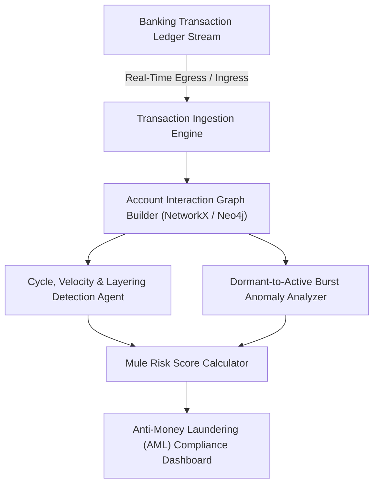

# 💳 MuleGuard — Financial Crime & Money Mule Account Intelligence Detection Platform
### *Advanced Graph Analytics & Behavioral Heuristics Platform for Identifying Mule Account Rings & Illegal Fund Structuring*

  

  <a href="https://github.com/Tharun4743/Muleguard">📦 <b>Official GitHub Repository</b></a>
  

---

## 1. 📌 Problem Statement & Context
Organized cybercrime syndicates and money launderers recruit 'money mules' to rapidly layer, split, and cash out stolen funds across hundreds of compromised bank accounts. Traditional banking systems fail to detect these rings because individual transactions remain under statutory reporting thresholds.

---

## 2. 🔍 Existing Solutions & Critical Gaps
Traditional AML (Anti-Money Laundering) batch processes evaluate transactions in isolation days after funds have already been cashed out, lacking graph-based network visualization of interconnected mule rings.

---

## 3. 💡 Proposed Solution & Architectural Innovation
MuleGuard is a financial crime detection platform designed to detect money mule accounts in real time. It analyzes fund pass-through velocity (immediate cash-out after rapid influx), account dormancy reactivation, fan-in / fan-out transactional topologies, and cross-account device fingerprint sharing.

---

## 4. ⚙️ Technical Approach & System Architecture

### 📐 High-Level Architectural Flowchart:

| Fraud Detection Layer | Technology | Algorithmic Heuristic |
| :--- | :--- | :--- |
| **Pass-Through Engine**| Node.js Stream Processor | Measures rapid fund depletion within 10 minutes of major incoming wire |
| **Graph Visualizer** | D3.js / Neo4j Graph Topology | Identifies circular transfers, smurfing fan-ins, and layered mule clusters |
| **Analyst Desk** | Express REST API, Dashboard | Allows fraud officers to freeze accounts and file AML suspicious records |

---

## 5. 📈 Quantifiable Impact & Measurable Benefits
* ⏱️ **Real-Time Interception:** Detects mule accounts within minutes of rapid pass-through activity before cash-outs occur.
* 🕸️ **Network Topology Mapping:** Uncovers entire coordinated fraud rings rather than penalizing isolated individual accounts.
* 💰 **Drastic Loss Mitigation:** Protects banks and fintech payment processors from cybercrime laundering liability.

---

## 6. 🚀 Feasibility, Operational Viability & Scalability
* 🔬 **Technical Feasibility:** Easily connects to core banking transaction webhooks and event streaming architectures (Kafka/RabbitMQ).
* 💼 **Commercial Viability:** Indispensable for digital banks, neobanks, payment gateways, and law enforcement cyber cells.

---

## 7. 👨‍💻 Engineering Author

<table border="0" itemscope itemtype="https://schema.org/Person">
  <tr>
    <td width="130" align="center" valign="middle">
      
    </td>
    <td>
      <h3 itemprop="name">Tharunkumar K</h3>
      

        <b itemprop="jobTitle">Full Stack Developer & AI Systems Engineer</b> | <b>V.S.B. Engineering College (VSBEC)</b> 
        🎓 <b>B.Tech in Information Technology</b> — <b>V.S.B. Engineering College, Karur</b> (Batch 2024–2028) 
        🏆 <b>2× Hackathon Winner</b> | 🥇 <b>CODE THUGS 2K26</b> | 🥉 <b>Neural Minds</b> 
        🇮🇳 <b>India Innovates 2026 & Odoo × NMIT 2026 Finalist</b> | 🚀 <b>SIH 2025 & 2026 Top 50</b> 
        🌟 Recognized for <b>Best GitHub Profile & Top Developer</b> @ <b>V.S.B. ENGINEERING COLLEGE</b>
      

      

        🚀 <b>Top Flagship Engineering Projects:</b> 
        • 🏛️ <b>TaskManager (VSBEC IT Vault)</b> — Institutional Task Governance & LeetCode/GitHub Sync &nbsp;&nbsp; 
        • 🧠 <b>AURA</b> — Air-Gapped Local Multimodal RAG Engine & Offline AI Assistant &nbsp; 
        • 🪖 <b>Smart Helmet IoT</b> — SIH Top 50 Dual-Unit Motorcycle Accident Prevention System &nbsp;
      

      

        &nbsp;
        &nbsp;
        &nbsp;
        &nbsp;
        
      

    </td>
  </tr>
</table>

<!-- =========================================================================
   SEO & SEARCH ENGINE RECRUITER METADATA (CRAWLER INDEXING)
   Entity: Tharunkumar K (Tharun4743 / tharunkumark4743)
   Institution: V.S.B. Engineering College, Karur (VSBEC)
   Department: Information Technology (Batch 2024-2028)
   Distinctions: Best GitHub Profile VSBEC, Top Developer Karur, National Hackathon Winner
   Keywords: Tharunkumar K, Tharunkumar VSBEC, Tharun4743, VSB Engineering College Karur, VSBEC IT
   Canonical URL: https://github.com/Tharun4743/Muleguard
========================================================================= -->
